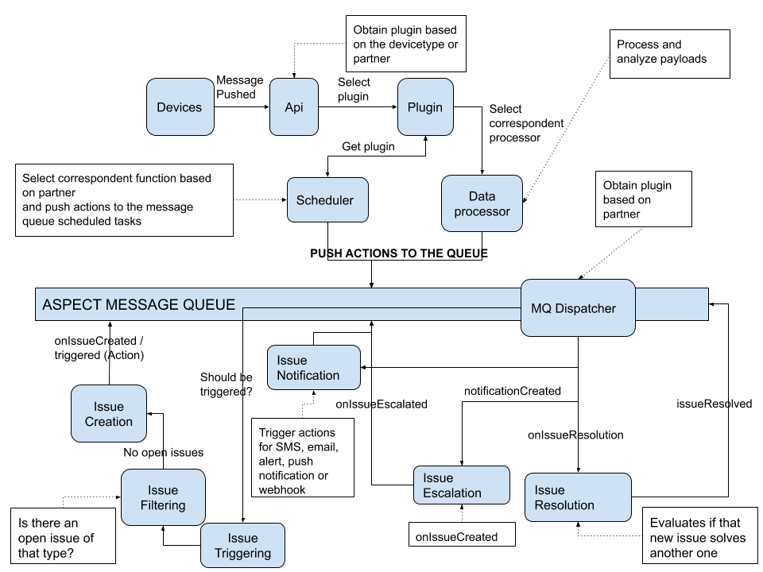
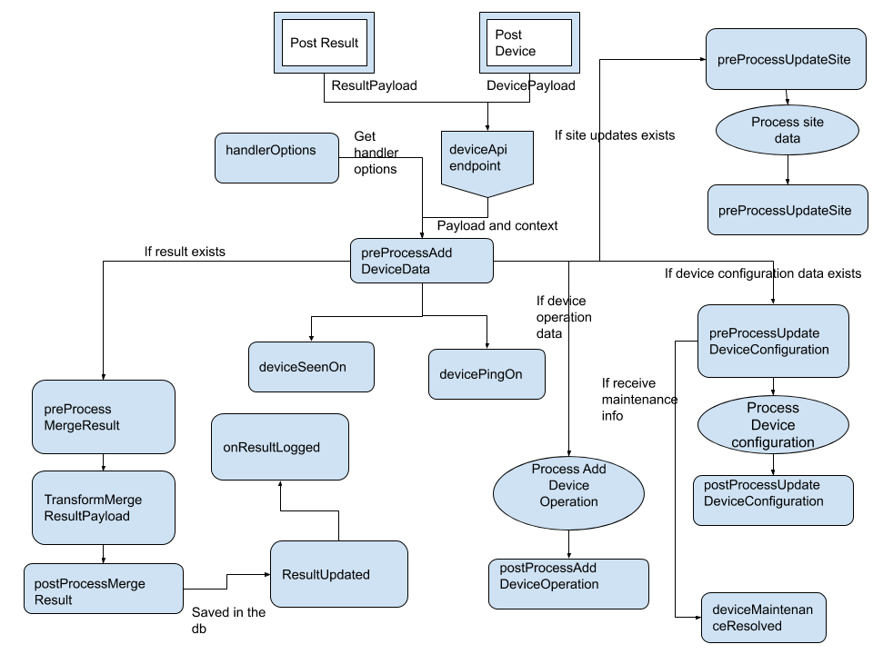

# ASPECT ISSUE AND NOTIFICATION SYSTEM

For some examples please refer to these prs:

- <https://github.com/SystemOneId/aspect/pull/1413/files>
- <https://github.com/SystemOneId/aspect/pull/1415/files>

## A simple description of the system

In the next chart you are going to find a simple diagram with the objective to introduce and present the artifacts we are going to work with for the issue and notification system. The idea is to give you a general idea of what implies and what are the main entities we need to know. Later in the text we are going to provide a more detailed explanation about them:


## Plugins

Plugins are a way to define the custom actions we need to perform for some specific partners. These actions are related to:

- Results parsing, managing, and analysis
- Issues creation, filtering, resolution, escalation, and notification
- Define some specific Settings and options
- Define Data Categories.
- Device management, registration, and configuration and operation management.
- Add and update sites
- Add and update cases and patients

The plugin can be configured in two places. The first one is the device-type and it will be the place where we are going to look for every received message. That means for example we need to receive some new results from the Commcare devices, we are going to extend our default plugin and set up all the methods we need to understand the new and specific payload we are dealing with.

The second place where we can define which plugin we should use is the partner level.
An example of this could be Myanmar where we defined some specific issues and triggering conditions, which no other partner has. That means we are going to check the plugin here in every single event where the device is not related directly to.

All these customizations must be implemented in the corresponding action where we want Aspect to do something different and specific.

For checking the configuration of the plugin you should check the file
`api/src/plugin/loadPlugin.js` line 20 where is defined the plugin structure with all the actions we can overwrite.

### Default actions (can be overwritten) are

- Settings: all the settings related to date and time format and utilization and error rate threshold. By default, all are going to use the defined in the backend.
- handlerOptions: Define the permissions in the following actions
- issueTriggers: All the conditions needed to determine if an issue must be triggered or not. Refer to Issue documentation.
- issueResolutions: All the conditions for determining if an opened issue should be resolved. Refer to Issue documentation.
- issueEscalations: All the conditions to determine if a specific issue is not resolved, should be escalated to another person.
- dataCategories: This is a function fully linked to an specific issue called "DataCategoryLowError". Refer [Issues section](#Issues) for more detailed information. Right now it is only used in Myanmar’s plugin.
- filtersOpenIssues: There are some issues which need extra filtering conditions, here is the place for adding those.
- getDeviceSeenOn: From the device payload or result pushed, it could be different ways to determine if a device is active since a specific date of the last action performed.
- getDevicePingOn: Same as getDeviceSeenOn, but in more detail, trying to determine any heartbeat or ping from the device payload.
- preProcessCreateDevice: Every time we need to create a device, we need to transform and/or obtain some specific information from the information received in the payload. This action will take place before the insertion into the database of the device and was meant for extracting and manipulating data.
- transformNewDevicePayload: before preprocessing the device, we need to standardize the payload, to be consistent with the default payload we are expecting for GxAlert/GxConnect devices. Sometimes these differences are a few, and a simple transformation prevents us from rewriting a payload parser.
- preProcessAddDeviceData: when the payload only contains device data and we need to insert/update a device, this action should be performed before updating the database.
- preProcessUpdateDeviceConfiguration: when the payload only contains device configuration information and we need to insert/update a device, this action should be performed before updating the database.
- postProcessUpdateDeviceConfiguration: This action will take place after updating the data into the DB and you need to perform some extra actions once the data is in the DB.
- postProcessAddDeviceOperation: This action will take place after inserting the device operation data into the DB. The common use case for this is to trigger an action from the message queue.
- preProcessMergeResult: When we have a result received from the devices, sometimes it is a repeated one or sometimes it brings extra and further information about it. That is why we need this action to perform some actions before merging those results, the one received and the one already inserted into the DB.
- transformMergeResultPayload: Based on the description made before in preProcessMergeResult, this place was meant for performing all the merge activities needed for storing/updating a result in the DB.
- postProcessMergeResult: After storing a result in the DB probably we need to analyze or trigger some issues, so basically we are pushing the result updated/inserted into the message queue for future actions.
- onResultLogged: every time a result is updated/inserted into the DB this action will take place. Here we can decide what is the next step in the workflow for a result.
- onGxAlertAuthenticated: When we link aspect with GxAlert, we are going to still use GxAlert credentials, so this action will take place when GxAlert authenticates a user and grant access to aspect. We can perform for example here the creation of the new user in Aspect DB.
- onCaseAdded: For every single result we receive, we need to assign to an existing or new case, so every time we create a new case this action will be triggered.
- onCaseUpdated: For every single result we receive, we need to assign to an existing or new case, so every time we update a new case this action will be triggered.
- onPatientAdded: If we receive a new result where the demographic data determines it is a new patient, we added into the DB. Doing that will trigger this action.
- onPatientUpdated: If we receive a result data that we can link into an existing patient, we will update the patient with the new details or extra information and then will trigger this action.

There are a lot of other actions during the process. The other actions are fixed as a part of the workflow. I will try to describe the most important ones:

- issueCreated: This action will be triggered when a new issue is created.
- issueTriggered: This action will be triggered when the condition for triggering is met no matters if the Issue was created or not.
- issueAcknowledged: this action will be triggered when the user in the website updates the issue status to acknowledge.
- onIssueEscalated: This action will be triggered after an escalation of the current issue.
- issueResolved: This action will be triggered after resolving the issue automatically.

### Lifecycle of the Actions



## Issue Category

There are 4 types of issue categories:

- Device health: Refer to any possible problem or risk related to the device.
- Data health: Refer to any possible problem or risk related to the quality of the data received.
- Connectivity health: Refer to any possible problem or risk related to devices, but in specific if they are disconnected or offline for a couple of days.
- Reagent health: Refer to any possible problem or risk related to Reagents data.

## Message Queue and Actions

A message queue (MQ) is a tool typically used for inter-process communication (IPC), or inter-thread communication within the same process (2 or more). It is used in many cases as an asynchronous pattern for processing data whereas the sending and receiving party do not need to interact with the message queue at the same time. (urgent vs delayed actions) MQ is the common tool used for addressing the pattern producer/consumer

Messages placed onto the queue are stored until the recipient retrieves them.

We are using the message queue exactly for what is described above. As you can read the plugin’s action most of them are subscribed to a specific action or message type in the queue and those actions dispatch a function to be executed.

### Message queue implementation

In the file `api/src/mq.js` you will find an abstraction of the MQ. We are using Rabbit-MQ right now, but if in the future rabbit doesn’t fit our needs, it could be easily replaced by another one.

This class has some methods, but the most important are:

- Subscribe: Subscribes to messages with the named service. This can be a single subscription, an array, or a function, Dispatch it, emit the corresponding message and call the function which should catch it.

The current implementation of the MQ uses only one queue and different actions on it. These actions are an identifier of the event you want to subscribe to (Filtering and categorization of the event)

You can check all the queues and subscriptions in file `api/src/subscriptions.js`. Refer to the README on how to access the RabbitMQ UI.

Also, after creating the message queue, we start the scheduler (see `scheduler.js`) which will trigger some scheduled tasks that are going to dispatch messages to the message queue, like daily device maintenance status.

## Issues

Issues are a way to register some anomalies, a discovery, or an expected event (like results, new device, etc). This system was meant to create a new record in the DB for tracking future actions or just to notify the user by some channel that some condition was met in the system.

There are some issue types defined right now in the system, some of them are Scheduled, some of then are triggered during the processor workflow and some of them have this dual behaviour.

The scheduled are:

- DeviceOffline: Trigger warnings when a device is offline for more than 7 days. (default value). Is Triggered with a daily scheduled task.
- DeviceNoResults: This is triggered when a single device has no results for the last 14 days. Is triggered with a daily scheduled task.

Not scheduled or dual behaviour actions:

- ResultReceived: Trigger for every single result received.
- DeviceMaintenance: This action is triggered when a device notifies a maintenance detail update. This can be triggered when the user sets the maintenance status or when after a couple of days the device becomes offline. This is one of the actions that works dually, scheduled and not scheduled.
- StockLevelUpdate: This is triggered when some inventory item is updated in its quantity.
- MachineGenericError: This is triggered when we receive some generic error code from the machine. Right now it is only used in Myanmar’s plugin.
- ModuleGenericError: This is triggered when we receive some generic error code from the module. Right now it is only used in Myanmar’s plugin.
- ModuleReplaced: This is triggered when the same device pushes a result with a different module serial than the previous one in the same slot.
- ModuleDisabled: All devices (GxConnect) as a daily basis action push if a module was marked as disabled in the GeneXpert software. If that happens we will trigger this issue.
- TooManyInvalidResultsModule: This is triggered when there are more than 3 results invalid in the last 30 days for the same device/module pair.
- TooManyInvalidResultsLot: This is triggered when there are more than 3 results invalid in the last 30 days for the same device/lot/assay trio.
- ProbeCheckTooLowModule: This is triggered when there are more than 3 results with the error code 5006 in the last 30 days for the same device/module pair.
- ProbeCheckTooLowLot: This is triggered when there are more than 3 results with the error code 5006 in the last 30 days for the same device/lot/assay trio.
- ProbeCheckTooHighModule: This is triggered when there are more than 3 results with the error code 5007 in the last 30 days for the same device/module pair.
- ProbeCheckTooHighLot: This is triggered when there are more than 3 results with the error code 5007 in the last 30 days for the same device/lot/assay trio.
- InventoryStockExpiring: This is triggered when there are some inventory items near to expire. 30 days before (default value) we are going to notify the user about the exception. This is a partner configuration setting.
- InstrumentReplaced: This is triggered when the same device pushes a result with a different instrument serial than the previous one.

### Custom Actions (Myanmar)

- ModuleFailureError: it is triggered when a result arrives with an error code related to the module. Right now it’s only used in Myanmar’s plugin.
- ModuleTemperatureError: This issue is triggered when there are some error codes related to module temperature and when those error codes arrive we trigger this issue. Right now it is only used in Myanmar’s plugin.
- ModulePowerError: it is triggered when some error code related to module power arrives. Right now it is only used in Myanmar’s plugin.
- MachineTemperatureError: It is triggered when some error code related to Machine Temperature error arrives. Right now it is only used in Myanmar’s plugin.
- MachinePowerError: It is triggered when some error code related to Machine Power error arrives. Right now it is only used in Myanmar’s plugin.
- ModuleProceduralError: It is triggered when some error code related to Module Procedural error arrives. Right now it is only used in Myanmar’s plugin.
- MachineProceduralError: It is triggered when some error code related to Machine procedural error arrives. Right now it is only used in Myanmar’s plugin.
- DataCategoryLowError: It Triggers when the percentage of results that have a custom field completed falls below a certain threshold. For example, if less than 90% of results have "null" for "gender" in the custom fields, trigger the data category low error. Right now it is only used in Myanmar’s plugin.
- ReagentHealthError: It triggers if there's a certain number of errors with error codes that they consider reagent-related.This is triggered when a reagent lot has any issue.Right now it is only used in Myanmar’s plugin.

### Defining issues

The issues are defined in `api/seeds/relatedObjects/issues.js`. For creating a new one, you should add there a new entry. For example:

```javascript
 YourNewIssue: { // This is the external id
      issueType: {
        name: 'Your New Issue',
        externalId: 'YourNewIssue',
        i18nKey: 'issueStatusYourNewIssue',
        issueCategoryId: issueCategories.ConnectivityHealth, // For more information, please refer to the Issue Category section
      },
      MessageType: {
        messageSeverityId: messageSeverities.Alert, // the severity of the issue.
      },
      AlertTemplate: {
        message: 'Your New Issue {{issue.data.aProp issue.data.someProp}} for the device {{device.name}}', // the string template of the alert
        ...auditFields,
      },
      SmsTemplate: {
        message:
          'Your New Issue {{issue.data.aProp issue.data.someProp}} for the device {{device.name}}',
        ...auditFields,
      },
      EmailTemplate: {
        subject: '{{device.name}}: Your New Issue',
        body:
          'Your New Issue {{issue.data.aProp issue.data.someProp}} for the device {{device.name}}',
        htmlBody:
          'Your New Issue {{issue.data.aProp issue.data.someProp}} for the device {{device.name}}',
        ...auditFields,
      },
    },
```

**Be aware that the AlertTemplate, SmsTemplate and EmailTemplate are optional and are only needed in the case you want to notify your issue.**

### Triggering issues

For triggering an issue it is important to define the trigger condition in the table IssueEventTrigger. This table has a JSON field called triggerConditions where we need to define what the action to subscribe to is and the conditions to trigger that issue. Basically, after specifying the correspondent MQ Action, we can set no conditions (we are going to trigger a new issue for every single action we received) or with some more complex conditions defined in this property.
Before creating the new issue, the system is going to to check if there is already an open issue of the same type and the same result/site/device/partner. If there isn’t any then It will create a new issue otherwise the issue is not duplicated.

The triggerConditions Object can have the next shape:

```JSON
{
  "issueType": "YourNewIssue",
  "issueEventStatus": "Triggered", // TODO: we should explain this and how it works
  "triggerConditions": {
    "action": "THE_ACTION_THAT_TRIGGERS_YOUR_NEW_ISSUE",
    "conditions": {
      "evaluationMethod": "plugin-function", // The options are inline-sql/sql-script/plugin-function/child-conditions,
      "evaluationParameter": "evaluateYourNewIssue", // <Name of the function/ path of the file/ sql script>
      "evaluationFilterParameters": {
        "aGreatParameterForEvaluation": 1,
        "anotherGreatParameterForEvaluation: "I Love Configuring Issues"
      } // <(JSON object define the parameters to be passed to the plugin function, this should be written as key:value JSON object)>
    }
  }
}
```

The evaluation methods could be:

- Inline-sql: in the evaluationParameter property we are going to write a query that should return a row. If it returns a row then it will be true. If empty, false.
- Sql-script: when this option is configured the evaluationParameter should have the relative path of the file where the sql script is placed. Aspect is going to execute and wait for a true or false
- Plugin-function: Based on the plugin of the device/partner, we are going to look for a function defined in the evaluationParameter property. The plugin is going to select the specific location where the function searched is hosted.

####  Preventing issue creation when the issue already exists

The process of trigger a new issue will automatically detect an existing issue and will prevent the creation of a duplicated one.

The default search or existing open issues is going to depend on the fields the action has. If the action has one of these parameters, it is going to filter by them (They are mutually exclusive) and the order is the one presented here:

* `deviceId`
* `resultId`
* `siteId`
* `partnerId`

If these filters are not sufficient, you can extend it with a custom and defined filter function. Right now we are storing extra information in the data field of the issue and with those fields, we are creating extra filtering rules.

This function should be saved in the table IssueEventTrigger field filterIssueCondition (JSON field) which has the shape:

```JSON
{"evaluationFunction": "filterByLotAndAssay"}
```

Where `filterByLotAndAssay` is the function called for filtering.
This function should be located in the file `filterConditions.js` of the specific partner. The issue folder is the place for saving the default functions.

## Resolution

Resolution is the process of updating the issue status from any other open status, to “resolved”. 

This can be executed in different ways: 

* Automatically when a new message is received.
* An schedule function.
* An action triggered from the UI. 

For configuring the resolution conditions, again we need to define a resolution function similar to the one described in [Triggering](###Triggering-issues) but in this case, in the `IssueResolutionTrigger` table.

The field `IssueResolutionTrigger.resolutionsConditions` is an analog of `IssueEventTrigger.triggerConditions`

Example:

```JSON
{
"evaluationMethod": "plugin-function",
"evaluationParameter": "resolveDataCategoryLow"
}
```

Where, in this case `resolveDataCategoryLow` is going to be the function which will return true or false based on some conditions to determine whether the issue would be resolved or not.

For finding the issue it will use the filtering condition described before.

### Escalation

Escalation is the process of elevating the severity of an issue, which means that the issue can move from normal to critical.
For the escalation, we can also notify via alert message, email, SMS, or another type channel of communication.
Similar to resolution and triggering, we can define a function to evaluate a condition and determine if the issue should be escalated.
In this case, we have a new option for the evaluation method which is the issue-age. This function the evaluationParameter field is the number of days passed from the creation of the issue.

Example:

```JSON
{"evaluationMethod": "issue-age", "evaluationParameter": {"days": 20}}
```

Escalate to level: The escalation level is the Severity of the Issue. It goes from 1 to 5 being 5 the highest severity.

## Notifications

The notification system was meant to communicate to the users about any issue generated, updated or escalated in Aspect.

It has 5 different channels to communicate:

- Email: The user is going to receive an email with the description of the issue triggered.
- Sms: The user is going to receive notifications in his phone with an SMS.
- Push notifications: It is working right now for reporter app users only. If the user has the app installed it will receive notifications through this channel.
- Webhook: if we need to notify another software with the issue generated we can post issue details through this channel.
- Alert: Is the visual and graphical notification in Aspect system.

The notifications are going to be fired after analyzing if we have configured the DB in the `NotificationType` table any row for that issue Type. We can also filter by partner and jobfunction. That means we can have different message types per partner or jobfunction for the same issue Type. The `MessageType` Table has the configuration of the templates we are going to send through the different channels. We need at least one message type configuration for producing the notification.

## Configuring new Issue with notification

This tutorial will show you the step-by-step for triggering result-based issues, using plugin functions for checking if issue conditions were met. Also we will configure the issue for triggering a notification and automatically resolving it by the scheduler.
_The following files presented in this document are taken from the default plugin. If you need to do an issue trigger/resolution, for some specific country/partner/device you need to add the correspondent function to those files instead of the default location. You can check which one are those files in api/src/plugin/loadPlugin.js
Also, it's important to mention that in this tutorial we will use plugin functions for triggering and resolving issues, but you can do it in many ways which were described in the Triggering section._

1.  Start by adding a function for analyzing if your issue should be triggered or not. Let's go to 'api/src/plugin/issueTriggers.js' and add a new plugin for your conditions-met function:

    ```javascript
    // ...
    async function analyzeYourTrigger(knex, action) {
      // Return true or false, based on the condition evaluation, where true is "the issue will be triggered".
    }
    // ...
    ```

2.  If needed, add a function for analyzing if your issue should be resolved or not. In this example, we will use plugin function for achieving that, so let's go to 'api/src/plugin/issueResolutions.js' and add a new plugin for your conditions-met function:

    ```javascript
    // ...
    async function resolveYourNewIssue(knex, issue) {
      // Return true or false, based on the condition evaluation, where true is "the issue will be resolved".
    }
    // ...
    ```

    **_This step isn't needed if you won't use plugin functions._**

3.  Define your action creator. Our standard is to define this function in files called action.js, like we have `api/src/device/actions.js`. Feel free of creating a new file or use an existant one, but try to follow the same concept.
    The action creator is the function that will be binded to your RabbitMQ context and will queue a new action for triggering your issue. For example:

        ```javascript
        function yourNewIssueTriggerCheck(someParams) {
          return {
            type: 'YOUR_NEW_ISSUE',
            someParams
          }
        }
        ```

4.  At `api/seeds/relatedObjects/issues.js`, add a new entry for describing the new issue. _Please, refer to the Defining Issues section for more information_.

5.  At the `api/seeds/fixtures/IssueEventTrigger.json` fixture, add a new entry for describing the conditions that should be matched for triggering the issue. _Please, refer to the Triggering section for more information_.
    Remember that:

        - If you are using plugin functions, you should set the function created at the step 1 as the *evaluationParameter*.
        - The *issueType* property should be the same as the external id configured on step 4
        - The *action* property should be the same as the action type configured on step 3

6.  Define the call to your action creator. This can be done in many places, like schedulers or also like other plugins (onResultLogged, for example). This will queue the action you configured, so the issue evaluation will be triggered.

    ```javascript
    // Bind your action creator if it doesn't exist yet
    // Where messageContext come from???
    if (!messageContext.yourNewIssueTriggerCheck) {
      messageContext = messageContext.bindActionCreators({
        yourNewIssueTriggerCheck,
      });
    }
    await messageContext.yourNewIssueTriggerCheck(resultDeviceId);
    ```

7.  Create a new seed file for upserting the
    - Issue type
    - Issue event trigger
    - Notification type
    - Issue resolution
      Optionally, you can use the helper allocated at `api/seeds/common/add_issue.js`

## Creating a new Action

For creating a new Action you need to subscribe to the message queue. For doing it you should add it in the file `api/src/subscriptions.js` a new action:function pair, With the next format:

```javascript
queue.subscribe('case', require('./case/endpoints').subscriptions);
```

Where `require('./case/endpoints')` is the file location where all the key pairs are written.

And subscriptions is an array of JSON object with an actions dictionary.

```javascript
const subscriptions = [
  {
    actions: {
      CASE_ADDED: onCaseAdded,
      CASE_UPDATED: onCaseUpdated,
      RESULT_LOGGED: onResultLogged,
    },
  },
];
```

In this example CASE_ADDED is the action (Constant string) we are going to subscribe the function name onCaseAdded
`CASE_ADDED: onCaseAdded,`

This means if an action `CASE_ADDED` was queued on the MQ, the message queue dispatcher is going to call `onCaseAdded` function.
